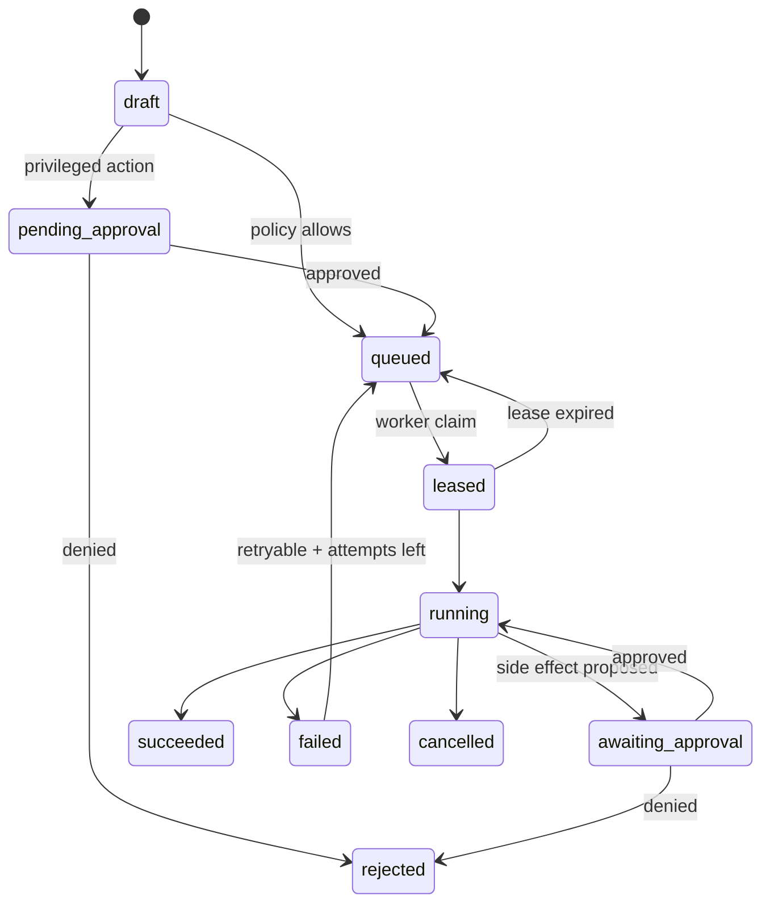
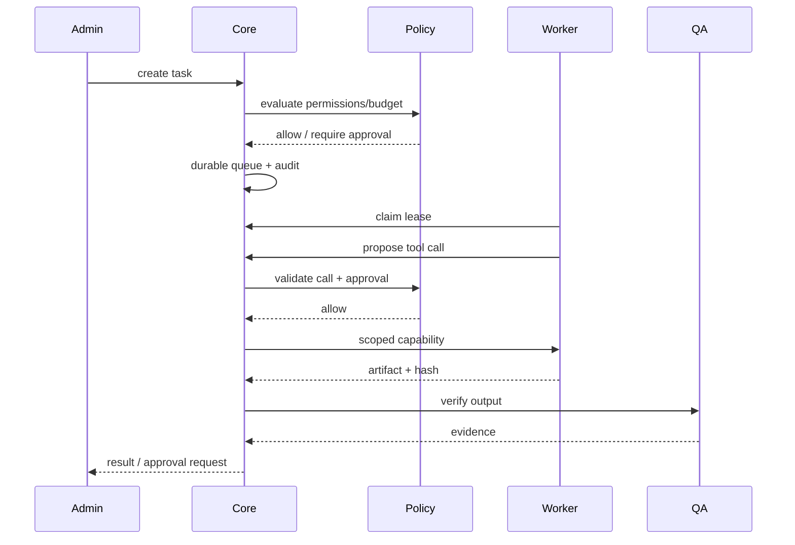

# Agent System — 20-Agent Orchestrator Design

> Phase 1 proposal. Not implemented. “20 agents” means 20 specialist roles under one durable scheduler, not 20 concurrent processes or an autonomous privilege grant.

## 1. Design principles

1. The model proposes; the core validates and executes.
2. Every action is a structured task with permissions, budgets, approvals and audit.
3. Durable state survives process restarts; leases prevent duplicate execution.
4. Default read-only; external side effects require approval.
5. Local-first routing is a policy choice, not a claim that a local model is running.
6. Specialist agents share memory through provenance-aware retrieval, not raw transcript sharing.

## 2. Specialist roles

| # | Agent | Objective | Default permissions | Typical outputs |
|---:|---|---|---|---|
| 1 | Chief of Staff | Decompose goals, route tasks | read projects/tasks | task DAG, summaries |
| 2 | Research | Authorized public/internal research | read, allowlisted fetch | cited briefs |
| 3 | SEO | Audits/keyword briefs | read analytics; optional DataForSEO | SEO reports |
| 4 | CRM | Contact/opportunity hygiene | read CRM; draft updates | CRM drafts |
| 5 | Email | Campaign drafts | draft; send requires approval | email drafts |
| 6 | WhatsApp | Official Meta Cloud API drafts | draft; send requires approval | template messages |
| 7 | Social | Social drafts/scheduling | draft; publish requires approval | post drafts |
| 8 | Content | Articles/case studies | draft content | Markdown/MDX |
| 9 | Higher Study | University/scholarship research | read education data | briefs/checklists |
| 10 | English Learning | Lessons/practice feedback | read learning data | lessons/rubrics |
| 11 | Software Architect | Plans/ADRs | read repo | design docs |
| 12 | Code Worker | Implement scoped changes | branch write; no main | commits/PRs |
| 13 | QA | Tests/repros | sandbox execute | test reports |
| 14 | Security | SAST/dependency/threat review | read; scan sandbox | findings |
| 15 | RE Analyst | Authorized binary/APK analysis | lab-only | artifacts/reports |
| 16 | DevOps | Deploy/backup plans | read infra; execute requires approval | runbooks/diffs |
| 17 | DB Steward | Schema/migration safety | read metadata; migration requires approval | migration plans |
| 18 | Memory Curator | Provenance/retention | write memory with policy | curated records |
| 19 | Creative Director | Decks/video/voice/CAD briefs | draft; render workers optional | creative artifacts |
| 20 | Super Admin Auditor | Governance/compliance review | read audit/approvals | risk/approval reports |

Roles are configuration, not hardcoded model prompts. Each maps to capabilities, policy, budget and allowed tools.

## 3. Task contract

```json
{
  "id": "task_uuid",
  "project": "alaminn",
  "agent": "research",
  "objective": "Produce a cited brief",
  "inputs": [{"type": "url", "uri": "https://example.com", "hash": "sha256:..."}],
  "permissions": ["research.read", "fetch.allowlisted"],
  "outputs": [{"type": "report", "schema": "BriefV1"}],
  "limits": {"deadlineMs": 600000, "maxTokens": 8000, "maxCostUsd": 0.5, "maxToolCalls": 20},
  "status": "queued",
  "retry": {"maxAttempts": 3, "backoffMs": 5000, "retryable": ["timeout", "rate_limit"]},
  "approval": {"required": false, "requestId": null},
  "idempotencyKey": "project:objective:input-hash",
  "audit": {"createdBy": "user", "policyVersion": "v1", "traceId": "..."}
}
```

Required fields: ID, agent, objective, inputs, permissions, outputs, limits/deadline, status, retry, approval, audit trail. Add project, environment, lease, capability token reference and artifact hashes.

## 4. State machine



- Claim must be atomic (transaction/conditional update), not find-then-update.
- Lease includes worker ID, expiry and fencing token; stale workers cannot commit.
- Side effects use idempotency keys; retries never duplicate sends/deploys.
- Terminal states emit audit events and artifact manifests.

## 5. Scheduling and modest hardware

- Queue priorities: governance > QA/security > user tasks > creative batch.
- Concurrency caps per agent/project/host; start with **1–2 workers** on modest hardware.
- Token/cost/time budgets enforced by core, not by prompt text.
- Model routing: local if configured/tested; otherwise optional approved providers; deterministic fallback labeled as non-LLM.
- Heavy GPU/RE/video jobs run on separate hosts or remain queued/disabled.

## 6. Tool and capability registry

Each capability declares: name, version, input/output schema, permission, risk class, sandbox requirement, egress domains, secret references, rate limit, approval rule, license evidence and owner. Skills/plugins are versioned artifacts; auto-update is disabled. MCP servers are adapters behind the same policy, not trusted bypasses.

## 7. Interaction example



## 8. Acceptance criteria

- [ ] Task survives restart; lease expiry requeues safely.
- [ ] Duplicate workers cannot both commit the same task.
- [ ] Budget/deadline exceeded stops execution.
- [ ] Privileged tool call without approval is denied and audited.
- [ ] Retry does not duplicate external side effects.
- [ ] Outputs validate against schema; artifacts are hashed.
- [ ] Agent cannot read another project’s memory or secrets.
