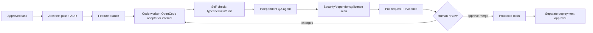

# Autonomous Software Factory — Approval-Gated Design

> Phase 1 proposal. Not implemented. The factory produces reviewed branches/PRs and test evidence; it never merges to main or deploys production autonomously.

## 1. Pipeline

## 2. Repo safety rules

- Work only on the session branch or factory-created feature branches; never push directly to main.
- Preserve source, DBs, configs and user data. No reset/clean/overwrite of production artifacts.
- Generated code is untrusted until reviewed; run in sandbox with repo-scoped token.
- No production secrets in prompts, logs, fixtures or artifacts.
- Dependency changes require lockfile diff, advisory scan and license review.
- Migrations follow [DEPLOYMENT_RUNBOOK.md](DEPLOYMENT_RUNBOOK.md): backup, restore test, disposable copy, comparison, approval.

## 3. Worker options

| Option | Fit | Gate |
|---|---|---|
| Internal code worker | Preferred core control | Build durable task/lease/policy first |
| OpenCode (MIT) | B adapter | Pin; sandbox; scoped repo token; SECURITY review |
| Pocock/Android/Claude skills | A/B artifacts | Human review; pin; disable auto-update |
| CLI-Anything | B harnesses | Review generated code; sandbox |
| Ruflo/Dify | D/C study/optional | Do not replace core; license/tenancy review |
| CodeRabbit | C optional PR review | Repo app least privilege; human merge |

## 4. Skill and plugin governance

Skills are versioned artifacts with hash, license, source, reviewer and allowed capabilities. Marketplace/auto-update installers are disabled by default. A skill cannot grant itself permissions; policy is evaluated by the core. MCP servers are registered adapters with egress and secret boundaries.

## 5. Generated-code acceptance

- [ ] Task contract and plan approved.
- [ ] Typecheck/lint/tests pass in CI.
- [ ] Security/dependency/license scans reviewed.
- [ ] No secret/PII in diff or artifacts.
- [ ] Migration safety evidence attached if schema changes.
- [ ] Human PR approval recorded; main protected.
- [ ] Deployment is a separate approval with rollback plan.

## 6. Failure handling

Failed QA returns structured findings to the code worker with attempt limits. Repeated failure escalates to human. Flaky tests are quarantined with owner/expiry, not silently skipped. The factory cannot disable assertions or security gates to make a build pass.
