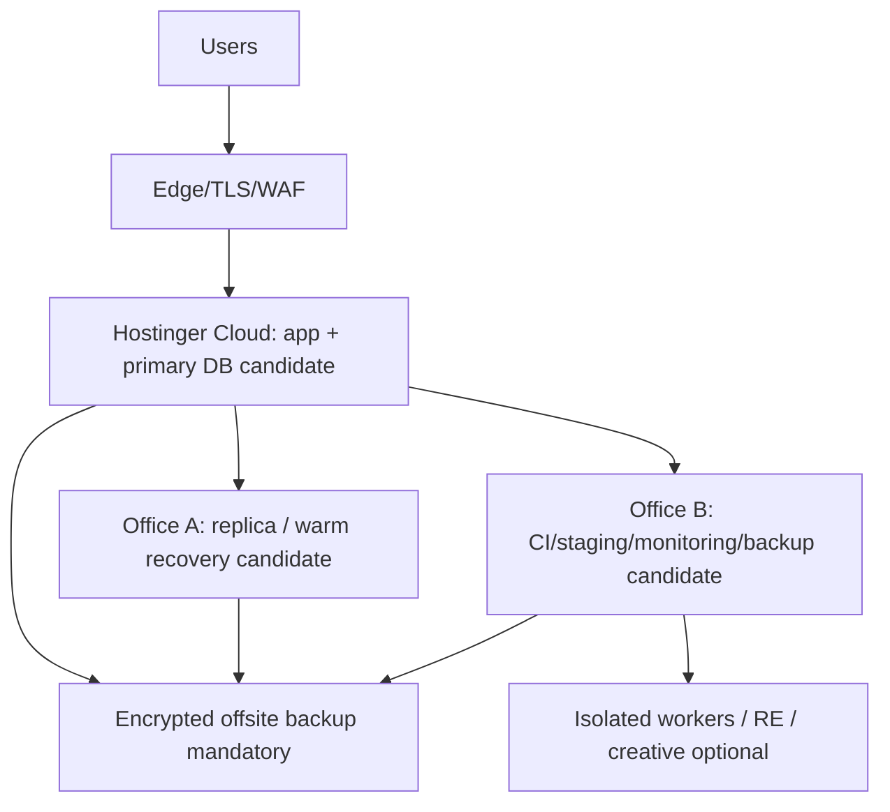

# Infrastructure Plan — Capacity, Topology, Backups

> Phase 1 proposal. Production capacity/topology is **not verified**. No host, firewall, DNS, TLS, database or backup change is approved.

## 1. Observed audit host (not production)

Linux x86_64, 2 CPUs, ~3.9GB RAM, ~15GB free disk, Node 22.22.3/npm 10.9.8. No Docker/Podman/Ghidra. This host can build/test the web app with constrained concurrency but cannot run the full creative/RE/GPU catalog. Postiz declares exact Node 22.23.4; OpenShorts documents 8GB+ RAM.

## 2. Target topology (candidate, verify first)

| Site | Candidate role | Verification required |
|---|---|---|
| Hostinger Cloud | Production app + primary DB | Actual DB engine/version, CPU/RAM/disk/IOPS, process manager, Node version, network/firewall, TLS, backup access |
| Office A | Replica/warm recovery | Hardware, uptime, power/network, replication lag, restore capability |
| Office B | CI/staging/monitoring/backup | Runner capacity, isolated VLAN, storage, monitoring retention |
| Offsite | Encrypted immutable backups | Provider, keys, restore test, retention, independence from both offices |

## 3. Database strategy

- Do not assume PostgreSQL. Runtime supports SQLite/libSQL and relational URLs; canonical CLI is SQLite; separate MySQL mirror exists.
- Phase 2 discovery must record provider/version per environment from configuration/metadata without exposing secrets.
- Keep current provider until an approved migration business case exists.
- Any migration: schema/data inspection → verified backup → restore test → disposable-copy migration → row/constraint comparison → approval → controlled execution → post-checks.
- SQLite/libSQL, MySQL and PostgreSQL have different locking, backup and migration semantics; never treat dumps as interchangeable.

## 4. Capacity scenarios

| Scenario | App/core | Workers | Storage | Notes |
|---|---|---|---|---|
| Minimum viable | 2–4 CPU, 4–8GB RAM | 1–2 queued workers | 50GB+ SSD | CPU-first; no local video/GPU; strict budgets |
| Recommended core | 4–8 CPU, 16GB RAM | 2–4 workers + queue | 100GB+ SSD | Separate DB preferred; monitoring/backups |
| Creative/RE add-on | Separate host | GPU optional/required per tool | 200GB+ | Voicebox/OpenShorts/CogVideo/Ghidra isolated |
| Local LLM | Separate inference host | Model-dependent | Model-dependent | Not verified; benchmark before claims |

Modest hardware remains viable through queues, concurrency caps, model routing, batching and disabling heavy optional workers. Do not schedule 20 agents as 20 simultaneous processes.

## 5. Queue and worker infrastructure

Current docs mention Redis/BullMQ but runtime is not verified. Proposal: durable DB-backed task queue first (fits existing Prisma), with atomic lease/fencing; add Redis/BullMQ only if measured need and approved. Workers are separate processes/hosts with task-scoped credentials. Heavy media/RE jobs never share the web process.

## 6. Backups and recovery

- Encrypted backups of DB, uploads/artifacts, configs (secret references, not plaintext keys) and audit checkpoints.
- 3-2-1 style: primary + office copy + independent offsite; immutable/WORM where possible.
- Proposed targets (to approve): RPO ≤ 1h for core DB, RTO ≤ 4h for warm recovery; creative artifacts may have different tiers.
- Restore tests on disposable hosts at least monthly and before migrations; record row counts/checksums and application smoke tests.
- Existing `scripts/backup-db.ts` / `restore-db.ts` support SQLite/MySQL paths but were **not executed** in Phase 0; restore overwrites live DB and requires explicit approval.

## 7. Network and secrets

- Default-deny worker egress; allowlist vendor domains; no cloud metadata access.
- RE/creative VLAN isolated from production DB/admin.
- Secret broker/manager; short-lived task tokens; rotation runbook; no `.env` mounts into untrusted workers.
- ngrok is dev-only with auth/expiry; never expose production DB/admin.

## 8. Monitoring

Track queue depth/age, lease expiry, task failure/retry, approval latency, audit write failures, model/provider cost/latency, DB size/locks, backup age/restore result, disk/memory pressure, egress denials and sandbox violations. Alert on audit chain break, backup failure and privileged action without approval.

## 9. Acceptance criteria

- [ ] Actual production provider/capacity/process manager documented.
- [ ] Backup and restore test evidence exists.
- [ ] Worker isolation/egress verified.
- [ ] Queue recovery tested under crash/restart.
- [ ] Capacity test passes at approved concurrency.
- [ ] Offsite encrypted backup independent of offices verified.
