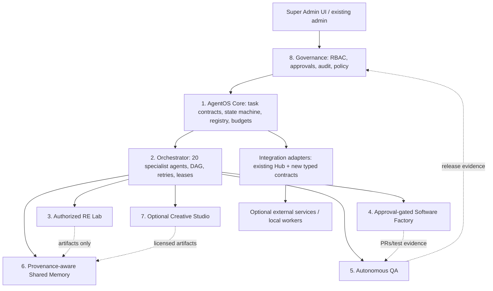

# AgentOS Master Architecture — Phase 0 Audit + Phase 1 Proposal

> **Status:** Phase 0 bounded discovery audit complete; Phase 1 architecture is a **proposal only**. No AgentOS layer, schema, queue, sandbox, model runner or production deployment was implemented in this phase. Implementation requires explicit human approval.
> **Audit date:** 2026-11-02. **Baseline:** `02eb68762ac4e3712eb9025ea3c8a7d9fa28760f` on `arena/10b72740-alaminn`.

## 1. Executive decision

Build AgentOS as an **independent, approval-gated control plane inside the existing ALAMINN application**, not by merging 79 external projects into one runtime. Reuse a small number of permissive skills and adapters; keep heavy, copyleft, custom-licensed, GPU and SaaS components outside the core. Preserve the current CRM, content, education, email, analytics and Integration Hub behavior.

The catalog audit found:

- **79 unique entries**: 52 expanded + 27 prior-only.
- **59 GitHub URLs queried**: 56 available, 3 unavailable.
- **20 website entries**: 19 fetched, one Meta AI portal returned 403.
- Fit classes: **A 4, B 22, C 20, D 21, E 4, F 8**.
- No entry is approved for production installation. A/B mean technical fit, not security or legal clearance.

Immediate blockers before implementation:

1. Existing dependency advisories, including a **critical Next.js 16.1.3** advisory set, must be triaged and remediated under change control.
2. Production database provider, host capacity, backup/restore and process manager are **not verified**.
3. Durable task execution, universal approval enforcement, sandboxing and provenance memory do not exist yet.
4. Several resource licenses/terms are custom, composite or unknown; model weights and media are separate from code licenses.
5. No local model is configured/tested; `local-grounded` is deterministic fallback, not local LLM inference.

## 2. Repository audit snapshot

### 2.1 Stack and scale

| Area | Observed state |
|---|---|
| Web | Next.js 16.1.3, React 19.2.3, TypeScript 5.9.3, Tailwind 4 |
| ORM | Prisma 6.19.0; 82 models, 0 enums |
| Runtime DB selection | `src/lib/db.ts`: PrismaLibSQL for file/libsql/http(s); PrismaClient for relational server URLs |
| Canonical CLI schema | `prisma/schema.prisma` + `prisma.config.ts`: SQLite/WASM, migrations under `prisma/migrations/sqlite` |
| Separate mirror | `prisma.config.mysql.ts`: MySQL schema/migrations/native engine; not executed in this audit |
| API surface | 214 `route.ts` files |
| UI surface | 139 page files, 66 under admin |
| AI | 63 prompt agents in 9 groups; 19 provider IDs; free-router, workflow executor, retrieval, registry, dashboard tools |
| Integrations | 42-entry registry; encrypted Setting keys; generic/httpsms/openrouter/meta connectors; reference/desktop modes |
| Side services | five mini-services: ai-worker, audit-worker, email-worker, health-monitor, notification-service |
| Docs | 35 Markdown docs before this audit |
| RBAC | 11 roles; namespaced permissions including `integration_settings.*`, `higher-study.*`, `english-learning.*` |
| Tests | Historical run at baseline: 19 files / 347 tests passed; typecheck 0; lint 0 errors/190 warnings; build 358 pages. Not rerun in Phase 0. |

### 2.2 Feature status

| Capability | Status | Evidence / gap |
|---|---|---|
| Public site, CRM, content, education kits | Implemented historically | Existing routes/tests; not re-certified in Phase 0 |
| Integration Hub | Implemented | Registry/store/connectors/UI/tests; encrypted settings; guarded probes |
| AI prompt workflows | Partial | `workflow-executor.ts` calls provider router and updates AiTask; not a general durable agent runner |
| AI background worker | Experimental | `mini-services/ai-worker/index.ts` polls queued rows; find-then-update is not an atomic multi-worker claim; no lease/retry/idempotency contract |
| Approvals | Partial | AiApproval + RBAC on AI task routes; not universal privileged-action enforcement |
| Audit log | Partial | `writeAudit()` swallows persistence errors; no signed/tamper-evident chain |
| Local inference | Not verified | Ollama provider code exists; `local-grounded` is synthesis fallback; no model benchmark |
| Durable queue/orchestrator | Planned | No BullMQ/Redis runtime verified; docs conflict with code |
| RE lab / software factory / autonomous QA | Planned | No isolated runner or approval-gated factory implemented |
| Provenance memory | Planned | Retrieval/knowledge code exists; no provenance/confidence/ownership schema verified |
| Production deployment | Approval-required / unverified | Manual CI-gated workflow exists; live host/DB/backups not inspected |

### 2.3 Architecture contradictions to resolve

- `docs/ARCHITECTURE.md` describes PostgreSQL 17 / Redis 7 / BullMQ / systemd as canonical; runtime and Prisma CLI use SQLite/libSQL plus a separate MySQL mirror.
- `docs/DEPLOYMENT-ARCHITECTURE.md`, deploy scripts and versioned-release workflow use PM2; other docs describe systemd; `deploy/install.sh` mentions Bun/Nginx/MariaDB.
- Docker Compose has MySQL/nginx commented out; Dockerfile builds with ephemeral `file:/tmp/build.db`.
- **Decision:** do not migrate or rewrite topology in Phase 0/1. Phase 2 must first discover the actual production environment and choose one documented runtime path.

## 3. Target eight-layer architecture

### Layer responsibilities

1. **AgentOS Core** — task envelope, policy evaluation, capability registry, idempotency, budgets, durable state, event log. No model vendor is mandatory.
2. **Orchestrator** — deterministic scheduler over structured tasks; specialist agents propose actions; the core validates permissions and executes only allowed tools. Target concurrency is configurable, not “20 processes at once.”
3. **RE Lab** — disposable, authorized-target analysis. Ghidra/REA/Android skills behind adapters; no production credentials; hostile binaries never run on the app host.
4. **Software Factory** — repo-scoped coding workers, branch/PR workflow, generated-code review, migration safety, human merge approval. OpenCode is a candidate adapter, not the core.
5. **Autonomous QA** — internal test/security/build gates first; TestSprite/CodeRabbit optional second opinions. AI cannot self-approve release.
6. **Shared Memory** — project-isolated, provenance-tagged records with confidence, ownership, retention and injection defenses. Not a chat transcript dump.
7. **Creative Studio** — optional workers for decks, diagrams, video, voice, CAD. Heavy/custom/copyleft tools remain isolated; publication is approval-gated.
8. **Super Admin Governance** — human approvals, policy, audit replay, secret rotation, kill switch, resource catalog and compliance register.

## 4. Component and data boundaries

| Boundary | Rule |
|---|---|
| Browser → app | Existing auth/RBAC; CSRF/origin checks; no secrets in client bundles |
| App → core | Typed task API; server-side policy; durable write before execution |
| Core → worker | Short-lived capability token; task-scoped inputs; no production DB URL |
| Worker → external | Egress allowlist; redaction; budget/rate limits; vendor approval |
| RE lab → core | Read-only artifact import; malware scan; provenance; no direct DB access |
| Factory → repo | Branch/PR only; protected main; human merge; signed commits preferred |
| Memory → prompt | Retrieval with provenance labels; untrusted content never becomes system instructions |
| Creative → publication | Human approval; license/asset provenance; platform policy checks |

## 5. Data architecture proposal (additive, not applied)

Preserve existing tables. Proposed new entities:

- `AgentTask`, `AgentTaskEvent`, `AgentLease`, `AgentArtifact`
- `AgentCapability`, `AgentPolicy`, `AgentBudget`
- `ApprovalRequest` (generalize beyond AiApproval), `AuditChainHead`
- `MemoryRecord`, `MemorySource`, `MemoryEmbedding`, `MemoryRetentionPolicy`
- `ResourceCatalogEntry`, `ResourceLicenseEvidence`, `ResourceAdoptionApproval`

Every task stores: ID, project, agent, objective, inputs, permissions, outputs, limits/deadline, status, retry policy, approval state, idempotency key and audit trail. Every memory record stores source URI/hash, timestamp, confidence, owner, project, classification and retention.

**Database safety:** inspect actual provider per environment; verified backup; restore test; disposable-copy migration; row/constraint comparison; approval; controlled execution. SQLite, MySQL and PostgreSQL are not interchangeable.

## 6. Deployment proposal

- **Hostinger Cloud:** candidate production/primary DB only after capacity/provider verification.
- **Office A:** replica/warm recovery candidate.
- **Office B:** CI/staging/monitoring/backup candidate.
- **Offsite:** mandatory encrypted backups, independent of both offices.
- **Modest hardware:** queues, concurrency caps, model routing, CPU-first workers; GPU video/RE workloads are separate and optional.

No topology change is approved. See [INFRASTRUCTURE_PLAN.md](INFRASTRUCTURE_PLAN.md) and [DEPLOYMENT_RUNBOOK.md](DEPLOYMENT_RUNBOOK.md).

## 7. Phase 1 design index

| Report | Purpose |
|---|---|
| [RESOURCE_AUDIT.md](RESOURCE_AUDIT.md) | 79-entry evidence-backed assessment |
| [RESOURCE_COMPATIBILITY_MATRIX.md](RESOURCE_COMPATIBILITY_MATRIX.md) | Fit, interfaces, local feasibility, gates |
| [LICENSE_COMPLIANCE.md](LICENSE_COMPLIANCE.md) | License/custom terms and adoption rules |
| [SECURITY_ARCHITECTURE.md](SECURITY_ARCHITECTURE.md) | Threat model, controls, audit findings |
| [AGENT_SYSTEM.md](AGENT_SYSTEM.md) | 20 agents, task contract, orchestration |
| [REVERSE_ENGINEERING_LAB.md](REVERSE_ENGINEERING_LAB.md) | Authorized isolated analysis |
| [AUTONOMOUS_SOFTWARE_FACTORY.md](AUTONOMOUS_SOFTWARE_FACTORY.md) | Code generation to approved PR |
| [QA_AND_TESTING.md](QA_AND_TESTING.md) | Reproducible quality gates |
| [MEMORY_ARCHITECTURE.md](MEMORY_ARCHITECTURE.md) | Provenance, isolation, retention |
| [INFRASTRUCTURE_PLAN.md](INFRASTRUCTURE_PLAN.md) | Capacity, topology, backups |
| [DEPLOYMENT_RUNBOOK.md](DEPLOYMENT_RUNBOOK.md) | Approval-gated operational procedure |
| [RISK_REGISTER.md](RISK_REGISTER.md) | Risks, owners, mitigations |
| [IMPLEMENTATION_ROADMAP.md](IMPLEMENTATION_ROADMAP.md) | Phases 2–7, estimates, acceptance |

Machine-readable evidence: [resource-assessments.json](audit/agentos-phase0/resource-assessments.json), [evidence-manifest.json](audit/agentos-phase0/evidence-manifest.json).

## 8. Approval requested before Phase 2

Approve **only** the next implementation slice after reviewing:

1. Production discovery and dependency remediation plan.
2. Additive task/approval/audit schema and rollback plan.
3. One durable worker and one low-risk read-only agent.
4. Sandbox/egress/secret boundary.
5. Resource shortlist and license decisions.

Production deployment, database migration, secret rotation, external publication and untrusted installs each require their own explicit approval.
