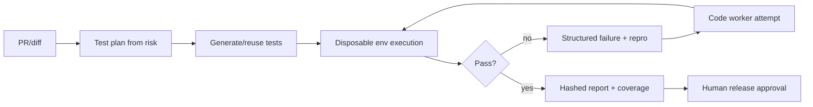

# QA and Testing Strategy

> Phase 0 baseline + Phase 1 target. Historical tests are evidence of a past run, not a current certification.

## 1. Baseline evidence

At `02eb687`: typecheck 0 errors; lint 0 errors/190 warnings; build 358 pages; Vitest **19 files / 347 tests passed**; live API/auth/encryption/masking/secret-retention flows passed; test settings cleaned. Browser visual/mobile verification was unavailable (Playwright CDN TLS reset; Chromium missing NSS/NSPR; apt unavailable). jsdom tests are not visual proof.

Phase 0 did **not** rerun the application test suite because it is documentation-only. It did run read-only npm audit and license inventory.

## 2. Quality gates

| Gate | Tooling | Blocking? |
|---|---|---|
| Typecheck | `tsc --noEmit` | Yes |
| Lint | ESLint | Yes for errors; warnings tracked |
| Unit/integration | Vitest | Yes |
| API contract | Live route tests against disposable DB | Yes |
| Security | Existing security suite + SAST/dependency scan | Yes for critical/high reachable |
| License | SBOM + license register | Yes for new dependencies |
| Build | Next standalone build | Yes |
| Browser E2E | Playwright/Chromium when available | Yes for UI changes |
| Performance/load | k6/autocannon or equivalent | For infra/queue changes |
| Migration safety | Backup/restore/disposable comparison | Yes for schema changes |
| AI output eval | Schema/citation/grounding checks | Yes for agent outputs |

## 3. Autonomous QA loop

QA agent cannot edit the code under test in the same privileged context; separation reduces “make the test pass” cheating. Test mutations that disable assertions/skips/security checks are rejected.

## 4. External QA services

- **TestSprite:** optional hosted second opinion; Apache-2.0 CLI verified but backend is SaaS; API key, data-processing and budget approval required.
- **CodeRabbit:** optional PR review/security; Deep Scan is not SCA/SBOM; human merge remains mandatory.
- Neither replaces internal CI, security gates or human approval.

## 5. Agent-specific tests

- Task lease/retry/idempotency and crash recovery.
- Policy denial, approval expiry/replay, audit failure fail-closed.
- Prompt injection via retrieved content/skills.
- Cross-project memory isolation.
- Sandbox egress/secret-mount negative tests.
- Budget/deadline enforcement.
- Model fallback labeling; no false “local inference” claims.
- License/provenance checks for generated artifacts.

## 6. Reproducibility

Every QA report records: commit SHA, lockfile hash, DB provider/version, seed/config (redacted), tool versions, model/provider/version if used, environment, start/end time, test IDs, artifacts and hashes. External side effects are mocked or require approval; tests never send real messages or deploy.

## 7. Acceptance criteria

- [ ] CI green on the exact release commit.
- [ ] Critical/high reachable advisories resolved or approved compensating controls.
- [ ] Browser/mobile checks for UI changes when tooling available; otherwise explicit gap.
- [ ] Migration restore/comparison evidence attached.
- [ ] Agent negative tests pass.
- [ ] Human release approval recorded.
