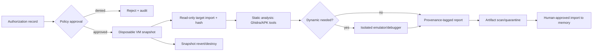

# Reverse Engineering Lab — Authorized, Isolated Analysis

> Phase 1 proposal. Not implemented. Only owned or explicitly authorized targets. Never bypass DRM, licensing, authentication or access controls.

## 1. Scope

Allowed: authorized APK inspection, owned binary analysis, protocol debugging of owned systems, malware-safe static analysis, reproducibility reports. Disallowed: production-host execution, credential theft, DRM/license/auth bypass, unauthorized network targets, consumer piracy tooling.

Catalog fit:

- **B:** Ghidra, REA, Android skills, CLI-Anything, ipftrace2 (privileged VM only), claude-video for authorized media evidence.
- **D:** Container, Cursor plugins, Meta cookbook patterns.
- **E:** AnyPS5, WiFi-Password-Cracker-Pro.
- **F:** exact SwiftUI Skills / God’s Eye View GitHub links remain unresolved.

## 2. Lab workflow

## 3. Authorization record

Required before analysis: target owner, scope statement, asset identifiers/hash, permitted techniques, expiry, approving human, legal basis, data-handling rules and destruction policy. The lab refuses tasks without a valid record.

## 4. Isolation requirements

- Dedicated VM or bare-metal lab host; never the production app host.
- Snapshot before each target; revert/destroy after.
- Non-root analysis where possible; no Docker socket; no host home/SSH/cloud metadata mounts.
- Default-deny network; isolated VLAN; no route to production DB or admin networks.
- CPU/RAM/disk/time limits; emulator snapshots; no shared clipboard/drag-drop with sensitive host.
- Tools pinned by version/hash; signatures verified; bundled GPL/LGPL notices retained.
- Ghidra scripts and REA skills are untrusted until reviewed; no auto-run.
- ipftrace2 requires root/kernel tracing and runs only in a disposable VM with BTF/kprobes/BPF; never production.

## 5. Toolchain proposal

| Tool | Role | Boundary |
|---|---|---|
| Ghidra headless | Disassembly/decompilation | VM; Java; pinned release |
| REA skills | Workflow guidance | Reviewed text; no bundled binary auto-exec |
| Android skills + SDK | APK/emulator analysis | Authorized APKs; test keystore only |
| CLI-Anything | Harness generation | Generated code reviewed before run |
| claude-video | Frame/transcript evidence | Authorized media; provider consent |
| ipftrace2 | Kernel packet tracing | Privileged disposable VM only |

## 6. Artifacts and memory

Outputs: target hash, tool versions, configuration, findings, screenshots, decompiled snippets (rights permitting), confidence, analyst, timestamp and authorization ID. Import into shared memory only after scan and human review. Decompiled proprietary code is not relicensed or copied into AgentOS.

## 7. Hardware

Modest lab: x86_64 VM, 4+ CPUs, 16GB RAM preferred, 100GB+ disposable storage. Ghidra on large binaries may need more. Android emulator needs KVM/nested virtualization. No GPU required for static analysis. Audit host (2 CPU/~3.9GB) is insufficient for a real lab and has no Ghidra/Docker.

## 8. Acceptance criteria

- [ ] Unauthorized target is rejected.
- [ ] VM has no production credentials/network route.
- [ ] Target/hash/authorization recorded before analysis.
- [ ] Tool versions pinned; scripts reviewed.
- [ ] Artifacts scanned and provenance-tagged.
- [ ] Snapshot revert/destroy verified.
- [ ] No DRM/auth/license bypass capability is exposed.
