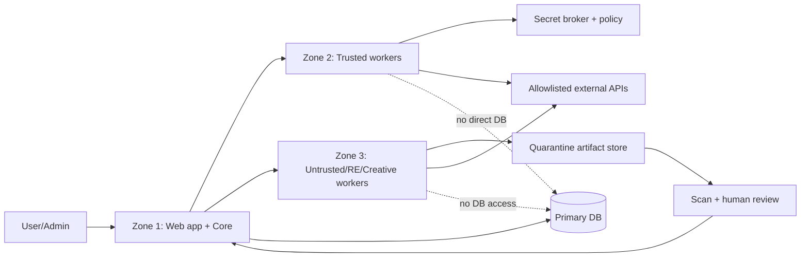

# AgentOS Security Architecture

> Phase 0 findings + Phase 1 target controls. **Proposed, not implemented.** No penetration test or full dependency clearance was performed.

## 1. Security posture today

| Control | Observed | Gap |
|---|---|---|
| AuthN/Z | Signed session cookie; `requirePermission()` rechecks active user/role in DB | Route-by-route enforcement; proxy is pass-through, not a global auth gate |
| RBAC | 11 roles, namespaced permissions | No agent capability tokens or task-scoped policy engine |
| Secrets | Integration/AI secrets encrypted in Setting; masked responses | Key management/rotation and agent exposure boundary not proven |
| Approvals | AiApproval + AI-task route checks | Not universal for deploy/DB/delete/publish/install |
| Audit | AuditLog rows; audit-worker reads | `writeAudit()` swallows failures; no hash chain/signing/replay protection |
| Rate limits | In-process maps; some route helpers | Not durable/distributed; Express shim gateway not wired as main runtime |
| Headers | CSP/HSTS/nosniff/frame deny in `src/proxy.ts` | CSP allows unsafe-inline/eval; preview relaxes frame ancestors in dev |
| Sandbox | None verified for agents | Container resource is not a sufficient boundary; Text-to-CAD daemon escapes agent sandbox by design |
| Egress | Connector URL guard for generic probes | No universal worker egress allowlist/DNS pinning |
| Supply chain | Lockfile; historical CI | npm audit reports advisories; external catalog not installed/scanned |

## 2. Dependency advisory snapshot (2026-11-02)

Read-only `npm audit --package-lock-only` against a copied lockfile:

- All dependencies: **45 affected package entries** (1 critical, 24 high, 14 moderate, 6 low).
- Production graph: **35 entries** (1 critical, 19 high, 10 moderate, 5 low).
- **Next.js 16.1.3** is marked critical by the advisory database, with multiple DoS/SSRF/auth-bypass/RCE-condition advisories. Reachability in this app was **not** proven; treat as a remediation gate, not a claim of exploit.
- Other direct high/moderate entries include nodemailer, prisma, sharp, zod, uuid, react-email, MDX editor and syntax highlighter. Some fixes are semver-major.
- Evidence: `audit/agentos-phase0/evidence-manifest.json` points to external `repository-audit/npm-audit*.json`.

**Rule:** no AgentOS worker receives production credentials until critical/high reachable paths are triaged, patched or formally risk-accepted with compensating controls.

## 3. Threat model

| Threat | Example | Required control |
|---|---|---|
| Prompt injection | Scraped page/skill tells agent to exfiltrate secrets | Treat retrieved content as data; policy engine outside model; tool allowlist; egress deny |
| Tool misuse | Agent runs shell/DB delete | Capability tokens; command allowlist; human approval; dry-run |
| Supply chain | Auto-updating skill/plugin, malicious dependency | Pin commits; disable auto-update; scan; signature/hash; quarantine |
| Sandbox escape | RE binary exploits parser; CAD daemon outside sandbox | Disposable VM; non-root; no host mounts; snapshot revert; no production network |
| Secret leakage | Worker logs API key; prompt includes DB URL | Secret broker; redaction; short-lived tokens; never mount .env |
| Cross-project memory | Tenant A retrieves Tenant B facts | Project/owner ACL on every query; row-level tests; encryption |
| Audit tampering | Admin edits logs | Append-only hash chain; external anchor; WORM/offsite copy; alert on write failure |
| Unauthorized publication | Agent posts/sends email | Human approval; platform policy; consent/suppression; idempotency |
| Resource exhaustion | 20 agents + video render on 4GB host | Queues; concurrency/CPU/RAM/token budgets; circuit breakers |
| Unofficial WhatsApp | WAHA/automation bypass | Official Meta Cloud API only; template/consent checks |

## 4. Target trust zones

- **Zone 1:** app/core, DB, audit, approval. No untrusted code execution.
- **Zone 2:** trusted internal workers; task-scoped credentials; egress allowlist.
- **Zone 3:** disposable VMs/containers for RE, generated code, media parsing, CAD, untrusted skills. Default deny network; no production secrets; read-only inputs; artifact-only output.

## 5. Approval matrix

| Action | Default | Approval |
|---|---|---|
| Read public repo metadata / internal read-only query | Allow within scope | None, audit logged |
| Create draft task/branch/PR | Allow | None, audit logged |
| Install dependency/skill/plugin | Deny | Human + license/security review |
| Execute generated/untrusted code | Deny outside sandbox | Human + sandbox policy |
| External send/publish/post | Deny | Human per action/campaign |
| Production deploy/merge to main | Deny | Human + CI evidence |
| DB schema/data migration, delete, restore | Deny | Human + backup/restore/disposable test |
| Secret rotation / infra destruction | Deny | Human + runbook |
| RE target analysis | Deny | Authorization record + lab policy |

Approvals bind to task ID, action hash, inputs hash, actor, expiry and environment. Reuse of an approval for changed inputs is invalid.

## 6. Audit and replay protection

Proposed append-only event:

`event_id, task_id, actor, action, resource, input_hash, output_hash, policy_version, approval_id, prev_hash, event_hash, signature, timestamp, environment`

- Write audit in the same transaction as state transition where possible.
- Fail closed for privileged actions if audit cannot persist.
- Periodic signed checkpoints to independent storage; alert on chain break.
- Redact secrets/PII before logging; retain hashes for correlation.
- Replay is deterministic only for recorded inputs/model versions; external side effects require idempotency keys and are not blindly replayed.

## 7. Sandbox requirements

- Non-root, read-only rootfs, dropped capabilities, seccomp/AppArmor, no Docker socket.
- Per-task CPU/RAM/PIDs/disk/time limits; default-deny egress with DNS/HTTP allowlist.
- No host home, SSH keys, cloud metadata, production DB or `.env` mounts.
- Snapshot/revert for RE; artifact scanning and quarantine before import.
- Text-to-CAD/CLI-Anything/Container require dedicated VMs because their documented boundaries are weaker than AgentOS needs.

## 8. Memory and prompt-injection controls

See [MEMORY_ARCHITECTURE.md](MEMORY_ARCHITECTURE.md). Minimum: provenance labels, trust tiers, project isolation, retrieval filters, instruction/data separation, citation requirements, and no automatic promotion of retrieved text to policy.

## 9. Security acceptance gates

- [ ] Critical/high dependency advisories triaged; reachable paths fixed or approved compensating controls.
- [ ] Every privileged tool call passes policy + approval + audit.
- [ ] Audit write failure blocks privileged action.
- [ ] Sandbox escape/egress/secret-mount negative tests pass.
- [ ] Cross-project memory access tests fail closed.
- [ ] Approval cannot be replayed across changed inputs/environments.
- [ ] Untrusted installs require human approval and pinned hashes.
- [ ] No production credentials in worker prompts/logs/artifacts.
